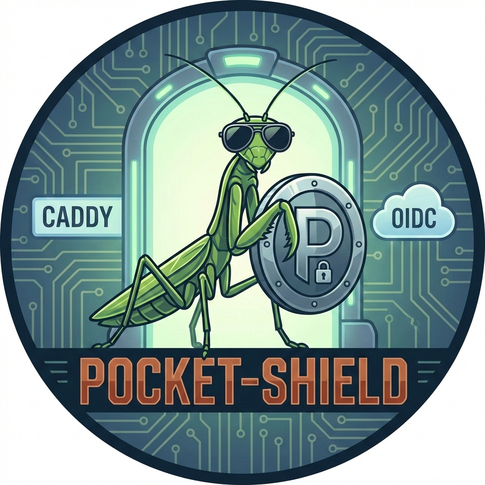

# pocket-shield



Minimal OIDC `forward_auth` gateway for homelab apps behind Caddy, with Pocket-ID as the IdP.

## Features

- `GET /verify` hot path for Caddy auth checks (local checks only, no outbound I/O).
- `GET /login` starts OIDC Authorization Code flow.
- `GET /callback` exchanges code, validates ID token, creates in-memory session.
- `GET|POST /logout` clears session cookie + RAM session.
- `GET /healthz` liveness endpoint.
- `--healthcheck` CLI mode for container health probes (no `curl`/`wget` required).
- Shared-secret guard on `/verify` via `Auth-Gateway-Secret`.
- Host-based authorization via group policy (`default_policy` + `host_policies`).
- Single-client mode or multi-client mode (client selected by host).
- OIDC discovery/JWKS with cache + refresh on `kid` miss.
- Optional PKCE (`enable_pkce`, default `true`).

## Build

```bash
cargo build --release
```

Binary:

```bash
target/release/pocket-shield
```

## Run

Default config path is `config.yaml` unless you pass `--config` or `POCKET_SHIELD_CONFIG`.

```bash
POCKET_SHIELD_CONFIG=./config.toml cargo run
```

or

```bash
./target/release/pocket-shield --config ./config.toml
```

## Healthcheck

Use the binary healthcheck mode to probe `GET /healthz` from minimal images:

```bash
./target/release/pocket-shield --config ./config.toml --healthcheck
```

Exit code is `0` on success and non-zero on failure.

For wildcard binds, healthcheck uses loopback automatically:

- `0.0.0.0:8080` -> `http://127.0.0.1:8080/healthz`
- `[::]:8080` -> `http://[::1]:8080/healthz`

Docker/Podman example:

```dockerfile
HEALTHCHECK CMD ["/app/pocket-shield", "--config", "/etc/pocket-shield/config.toml", "--healthcheck"]
```

## Configuration

- Config format: YAML, JSON, or TOML.
- Start from `config.example.toml`.
- `issuer` and `gateway.public_base_url` must be `https://`.
- `gateway.gateway_shared_secret_file` and client secret file paths must exist and contain non-empty secrets.
- Callback URL is derived automatically as `public_base_url + /callback`.
- Redirects (`rd`, `safe_default_rd`, `logout_redirect`) are restricted to `gateway.allowed_redirect_root_domain`.

### Modes

- `mode = "single"`: use `[single_client]` for every host.
- `mode = "multi"`: use `[[multi_clients]]` keyed by host.

### Authorization policy

- `default_policy.allowed_groups`: fallback groups for hosts without overrides.
- `[[host_policies]]`: per-host allowed groups.
- Empty allowed-groups means "any authenticated user is allowed".

## Endpoint Contract

### `GET /verify`

Expected request headers (from Caddy):

- `Auth-Gateway-Secret`
- `X-Forwarded-Host`
- `X-Forwarded-Proto`
- `X-Forwarded-Uri`

Behavior:

- Invalid/missing shared secret -> `403 forbidden`
- Missing/expired session -> `302` redirect to `/login?rd=<original-url>`
- Valid session but not authorized for host policy -> `403 forbidden`
- Valid + authorized -> `204 No Content` with identity headers:
  - `remote-user`
  - `remote-email` (if present)
  - `remote-name` (if present)
  - `remote-groups` (comma-separated)

### Other endpoints

- `GET /login?rd=<https-url>`: validates redirect target and redirects to IdP authorize endpoint.
- `GET /callback?code=...&state=...`: validates login state, exchanges code, validates ID token, sets session cookie, redirects to original `rd`.
- `GET|POST /logout`: removes session and clears cookie, then redirects to configured logout destination.
- `GET /healthz`: returns `200 ok`.

## Caddy Integration Checklist

- Point `forward_auth` at `http://pocket-shield:8080/verify` (or equivalent internal address).
- Ensure Caddy sends the required forwarded headers and `Auth-Gateway-Secret`.
- Copy `remote-*` response headers from auth check into upstream request headers.
- Strip any inbound client-supplied identity headers before proxying to apps.
- Do not apply `forward_auth` to Pocket-ID endpoints or gateway login/callback/logout endpoints.

### Example Caddyfile

```caddyfile
{
	# Store this in your environment, not inline in Caddyfile.
	# AUTH_GATEWAY_SECRET=...
}

auth.home.example.com {
	# Gateway endpoints
	@gateway path /verify /login /callback /logout /healthz
	reverse_proxy @gateway pocket-shield:8080

	# Pocket-ID endpoints
	@pocketid path /.well-known/openid-configuration /authorize /token /jwks
	reverse_proxy @pocketid pocket-id:1411
}

paperless.home.example.com {
	# Prevent client header spoofing.
	header {
		-Remote-User
		-Remote-Email
		-Remote-Name
		-Remote-Groups
	}

	forward_auth pocket-shield:8080 {
		uri /verify
		copy_headers Remote-User Remote-Email Remote-Name Remote-Groups
		header_up Auth-Gateway-Secret {env.AUTH_GATEWAY_SECRET}
	}

	reverse_proxy paperless:8000
}
```

## Notes

- Sessions are RAM-only; process restart logs everyone out.
- Cookie settings: `Secure`, `HttpOnly`, `SameSite=Lax`, domain-scoped via `gateway.cookie_domain`.
- Login and callback endpoints are rate-limited per source IP.

## License

Licensed under the [MIT License](LICENSE).
